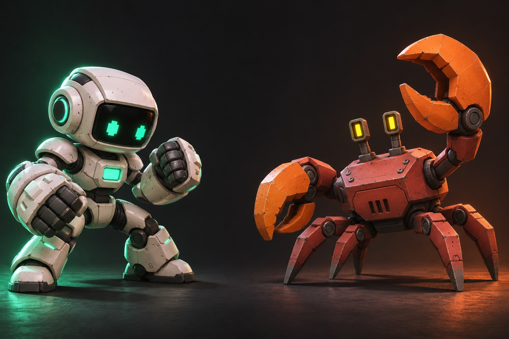

# VirtuAI Fighter

VirtuAI Fighter is a 3D arcade fighting game for the browser. Pick Codex, Claude Crab, Copilot, or Gemini and face a CPU rival in The Foundry.

## Play in your browser

Open [VirtuAI Fighter on GitHub Pages](https://shumow.github.io/virtuai-fighter/), select your fighter and a **CPU Rival**, then click **Start Fight**.

## Play offline

1. Open the [v0.1.0-alpha.1 release](https://github.com/shumow/virtuai-fighter/releases/tag/v0.1.0-alpha.1) and download **VirtuAI-Fighter-v0.1.0-alpha.1.zip** from **Assets**.
2. Extract the ZIP, then open `VirtuAI-Fighter/index.html` in your browser. The extracted game runs offline without an install or a server.
3. Select your fighter, choose a **CPU Rival**, and click **Start Fight**.

If you already have this repository checked out, open `index.html` from the checkout.

## Controls

| Key | Action |
| --- | --- |
| **← / →** | Move left or right |
| **↑ / ↓** | Sidestep away from or toward the camera |
| **A** | Quick strike |
| **S** | Heavy attack |
| **D** | Fighter special, with a cooldown |
| **Space** | Hold to guard |
| **Esc** | Pause or resume |

On the alpha.2 build, turn your phone to landscape. Use the directional pad with your left thumb and tap **Strike**, **Heavy**, or **Special** with your right. Hold **Guard** to block. Rotating the phone during a fight pauses it until you tap **Resume**.

As Gemini, hold **↑** or **↓** while pressing **D** or tapping **Special** to choose the direction of Parallax’s sidestep.

## Win the match

Win two 45-second rounds. Take out your rival’s health, knock them off the platform, or finish the round with more health when time expires. A drawn round is replayed. After the match, choose **Rematch** or return to fighter select.
